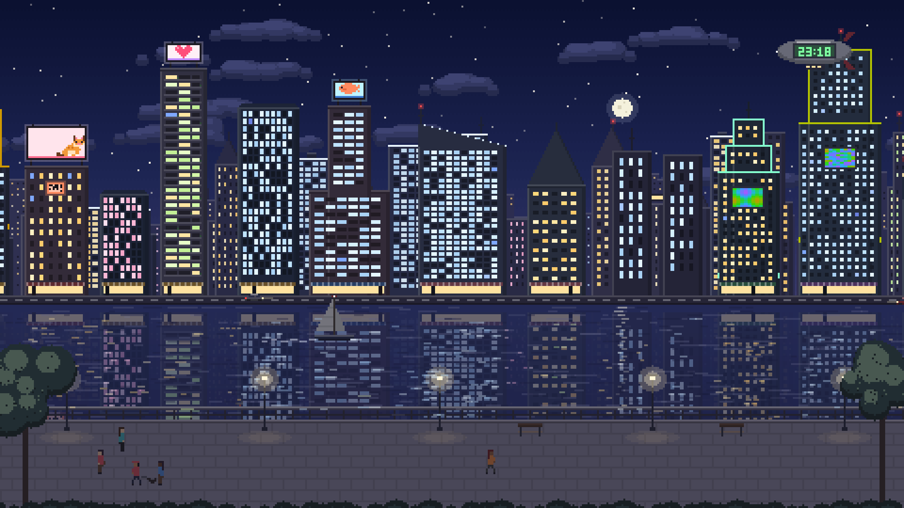
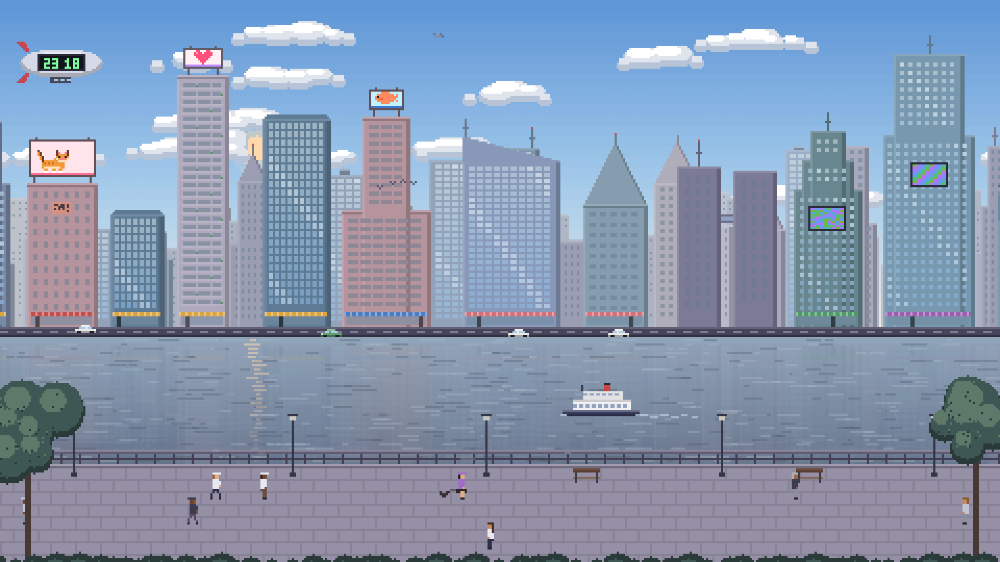
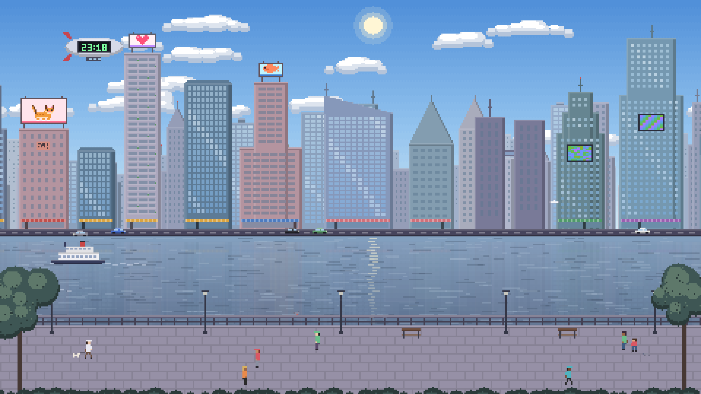
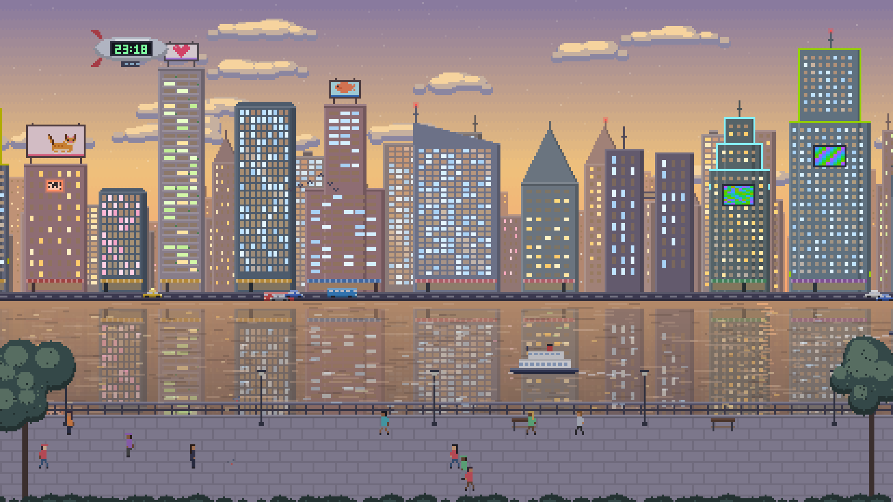
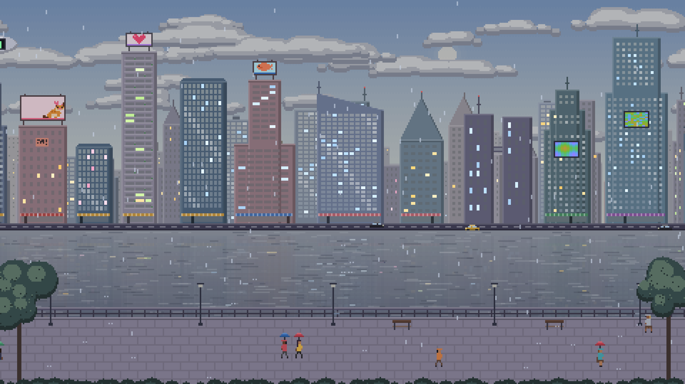
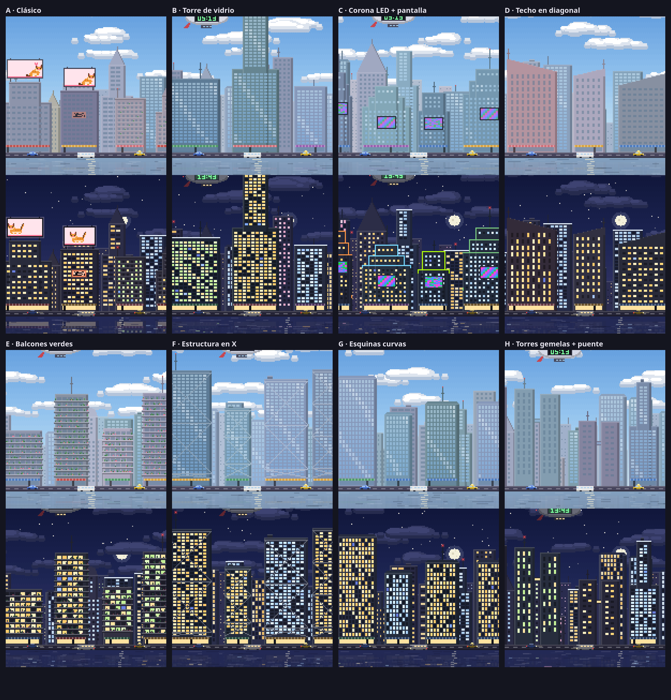

# Pixel City

Fondo de pantalla animado para **KDE Plasma 6**: una ciudad en pixel art junto al agua, generada
completamente por código (sin videos ni imágenes).

**[Página en la tienda de KDE](https://www.opendesktop.org/p/2381973/)** · [Guía de instalación](INSTALACION.md)



## Qué tiene

- **Luz según la hora real**: amanecer, día con sol, atardecer dorado, noche con luna, estrellas y
  alguna estrella fugaz.
- **Ciudad variada**: torres de vidrio que reflejan el cielo, vidrio con techo en diagonal, coronas
  LED que cambian de color, pantallas animadas, balcones con plantas, torres gemelas y edificios
  clásicos con anuncios en la azotea (incluido un gatito que camina, se acicala y salta).
- **Vida**: gente paseando (con perros, familias, corredores), palomas que se espantan cuando alguien
  pasa, bandadas, gaviotas, autos, taxis y autobuses, ferris, veleros y lanchas.
- **Dirigible con reloj** que muestra la hora actual.
- **Clima**: de vez en cuando llueve y la gente saca paraguas.
- **Ligero**: dibuja en un lienzo de 270 líneas escalado sin suavizado, y se **pausa** cuando la
  ventana activa está maximizada o a pantalla completa.

| Mañana | Mediodía | Atardecer | Lluvia |
|---|---|---|---|
|  |  |  |  |

## Instalación

**Desde Plasma (lo más fácil):** clic derecho en el escritorio → **Configurar escritorio y fondo** →
**Obtener nuevos complementos** → busca **Pixel City**. También está en la tienda:
[opendesktop.org/p/2381973](https://www.opendesktop.org/p/2381973/).

**Desde el código:**

Requiere KDE Plasma 6. Instrucciones paso a paso, actualización y solución de problemas en la
**[guía de instalación](INSTALACION.md)**. Versión corta:

```bash
git clone https://github.com/xaw624/pixel-city.git
cd pixel-city
./install.sh --activate
```

¿Usas un agente de código (Claude Code, Codex, Cursor…)? Pídele que siga [AGENTS.md](AGENTS.md).

Luego: clic derecho en el escritorio → **Configurar escritorio y fondo** → en "Tipo de fondo" elige
**Pixel City**.

Para actualizar después de cambiar el código:

```bash
kpackagetool6 -t Plasma/Wallpaper -u package
systemctl --user restart plasma-plasmashell.service
```

Para desinstalar:

```bash
kpackagetool6 -t Plasma/Wallpaper -r org.xaw.pixelcity
```

## Rendimiento

Medido en una laptop con i5-8300H a 1920×1080 (proceso `plasmashell` completo, incluidos los widgets):

| Situación | CPU | RAM |
|---|---|---|
| Fondo visible | ~9% de un núcleo | ~370 MB |
| Ventana activa maximizada (en pausa) | ~2–3% de un núcleo | ~370 MB |

## Cómo está hecho

- `package/contents/ui/scene.js`: todo el motor de la escena (generación de la ciudad, paleta según
  la hora, simulación y dibujo). Usa solo la API de Canvas 2D, así que funciona igual en QML y en el
  navegador.
- `package/contents/ui/main.qml`: el fondo de Plasma. Apila las capas (cielo, nubes, ciudad,
  ambiente a 4 fps, vida a 12 fps, primer plano) y las escala a pantalla completa.
- `preview.html`: vista previa en el navegador. Parámetros: `?hour=18.5`, `&rain=0.8`, `&live=1`
  (animada), `&seed=7`.
- `catalog.html`: hoja con todos los estilos de edificio, de día y de noche.
- `cat-test.html`: fotogramas de la animación del gato.



## Licencia

MIT
